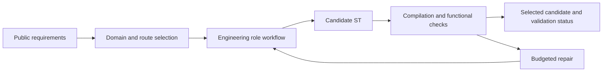

# RL-MAR: Reinforcement Learning-based Multi-Agent Routing for Verifiable PLC Code Generation

[中文说明](README_zh.md)

RL-MAR generates IEC 61131-3 Structured Text (ST) programs from natural-language
requirements. It selects engineering roles and execution topologies, generates
candidates, and uses compilation and functional-verification feedback to guide
budgeted repair and route-policy learning.



ANTLR syntax checks, CODESYS compilation and functional verification are
separate stages. A compilation pass is not a functional pass.

## Repository layout

```text
framework/
  MAR/                       Routing, agents, roles, budgets and verification
  Datasets/                  Public 94-task dataset and loader
  CODESYSCompileService/     Windows CODESYS HTTP compilation service
  models/                    Encoder provenance; weights obtained separately
experiments/
  runners/                   Training and evaluation entry points
  profiles/                  Workflow and ablation profiles
  baselines/                 Sanitized comparison-method snapshots
  paper/                     Saved-result analysis and explicit ABI adapters
results/                     Selected aggregate evaluation results
docs/                        Reproduction notes and figure sources
data/                        Dataset location note
```

The public selection excludes model weights, private evaluator resources,
training checkpoints, raw model responses, per-task run archives and editable
manuscript tables. Sanitized Direct Generation, AutoPLC and LLM4PLC baseline
snapshots are included under `experiments/baselines/`.

## Start here

The [public dataset](framework/Datasets/plcdataset.json) contains 94 records in
a JSON array across five control domains: Sequential Logic, Process Control,
Motion and Sorting, Data Handling and Communication, and Safety and Monitoring.
Inspecting it does not require credentials or CODESYS.

To regenerate figures from the saved aggregate report:

```bash
python -m pip install numpy matplotlib
python docs/figures/generate_experiment_figures.py --report results/paper_plot_report.json --outdir figure_output
```

This redraws saved results; it does not rerun evaluations.

## Framework setup

Use an isolated Python environment. Python 3.10+ is a development starting
point, not a tested cross-platform support guarantee. Functional94 and
RuSTy/Docker verifier paths require a compatible Linux environment; the CODESYS
service runs separately on Windows. See [reproduction notes](docs/REPRODUCIBILITY.md)
for known startup limitations.

```bash
python -m pip install -r framework/requirements.txt
python -m pip install antlr4-python3-runtime==4.13.1 psutil
```

Obtain [sentence-transformers/all-MiniLM-L6-v2](https://huggingface.co/sentence-transformers/all-MiniLM-L6-v2)
separately and set `LOCAL_MODEL_PATH` to its local directory. Runtime loading is
local-only; weights are not tracked in Git. The recorded local snapshot hash is
in [encoder provenance](framework/models/PROVENANCE.md).

The repository root and `framework/` must be on `PYTHONPATH` for entry points
that import `framework.MAR` or `MAR`. From the repository root in Linux:

```bash
export PYTHONPATH="$PWD:$PWD/framework${PYTHONPATH:+:$PYTHONPATH}"
export LOCAL_MODEL_PATH="/path/to/all-MiniLM-L6-v2"
```

Review [.env.example](.env.example), copy it to an ignored local `.env`, and
configure the backend you actually use. Some runners accept `--env-file`;
others read process environment variables. Not every runner automatically loads
the same environment file.

For CODESYS compilation, install CODESYS V3.5 with ScriptEngine on Windows:

```powershell
python -m pip install -r framework/CODESYSCompileService/requirements.txt
Set-Location framework/CODESYSCompileService
python HTTP_SERVER.py
```

Configure `CODESYS_HOST` and `CODESYS_PORT` in the client environment. The
service defaults to port 9000 and chooses a local IPv4 address; it does not
unconditionally bind to `0.0.0.0`. Set `CODESYS_PATH` if necessary.

## Experiments and results

[Experiment entry points](experiments/README.md) describe the current runners.
Full evaluation requires an authorized evaluator, contract-bearing inputs,
provider and run settings, and the expected checkpoint. These resources are
not all included. The public 94-task JSON array is not a drop-in input for
the Functional94 JSONL contract.

| File | Content |
| --- | --- |
| [paper_unified_summary.json](results/paper_unified_summary.json) | Method/model compilation, functional-pass and generation-cost summaries |
| [paper_paired_statistics.json](results/paper_paired_statistics.json) | Paired statistical comparisons |
| [paper_plot_report.json](results/paper_plot_report.json) | Figure-generation input |

Saved RL-MAR summaries report 144 functional passes out of 470 primary
model-task evaluations and 148 out of 470 confirmation evaluations across
five backbones. These are archived results, not a fresh evaluation in the
reader's environment. Recomputing paired statistics requires the authorized
per-task archive.

## Updating from the earlier layout

The former `experiments/run_plc.py` entry point is absent in this snapshot;
do not reuse its old command line. Current runners are under
`experiments/runners/`. The public dataset changed from JSONL to a JSON array;
ten records differ from the June 2026 snapshot. The current `PLCDataset`
loader accepts both representations. Old per-task result folders and the old
architecture image are not part of the selected current distribution.

## Attribution and terms

The root [LICENSE](LICENSE) is temporarily retained from the earlier public
repository pending a separate licensing review. Third-party components retain
their own terms; see the [comparison-method notices](experiments/baselines/README.md).

We acknowledge [LLM4PLC](https://github.com/fakih-/LLM4PLC),
[AutoPLC](https://github.com/cangkui/AutoPLC),
[CODESYSCompileService](https://github.com/cangkui/CODESYSCompileService), and
[Agents4PLC](https://github.com/Luoji-zju/Agents4PLC_release). Upstream links do
not establish identical provenance or redistribution terms for a local adaptation.
